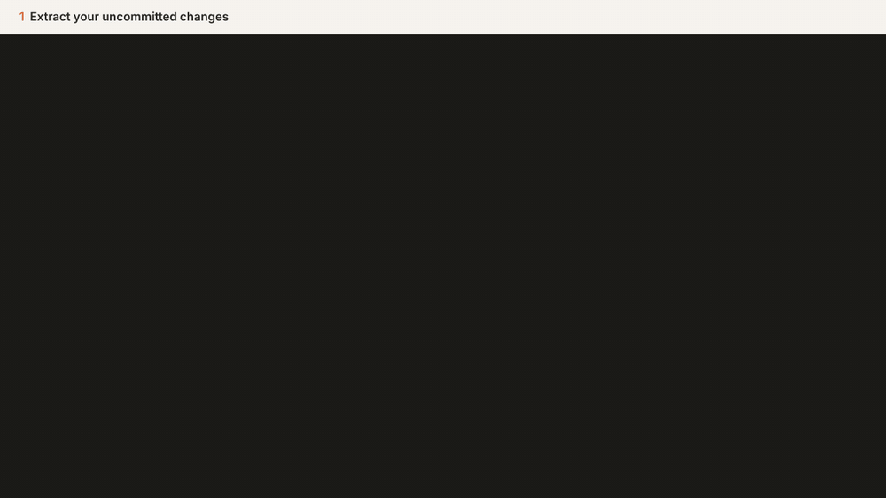

<p align="center">
  
</p>

<h1 align="center">spark-joy</h1>

<p align="center"><em>Make PRs spark joy again.</em></p>

<p align="center">
  <a href="https://www.npmjs.com/package/@dansyuqri/spark-joy"></a>
  
</p>

AI-written PRs are often thousands of lines long: too big to review properly. spark-joy has your coding agent split a PR into small, ordered chunks, then opens a local app where you review them one at a time, see how they connect on a map, and finish with a summary of what the PR does.

**Example:** spark-joy's own history, one 7.8k-line diff, became **18 chunks of 141–369 lines**, every hunk placed exactly once. The 2.7k-line lockfile went straight to *skim*.

<p align="center"></p>

Writing the big PR yourself? spark-joy can also split your staged, uncommitted or branch changes into small stacked PRs. See [Split your own changes](#split-your-own-changes).

Works from plain git, so GitHub, GitLab or anything else. Nothing is posted unless you ask; notes export as markdown, or go to a GitHub PR as a pending review.

Inspired by [mr-cast](https://github.com/phanshiyu/mr-cast).

## How it works

```
spark-joy extract   →  hunks.json    every hunk of the diff gets an id (h001, h012.1, …)
the agent (skill)   →  plan.json     hunks grouped into chunks, in two review orders, plus a feature list
spark-joy validate  →  ok / errors   every non-mechanical hunk is in exactly one chunk, sizes are sane
spark-joy serve     →  review app    choose an order, review chunk by chunk, export review.md
```

- **The agent never copies code into the plan.** It refers to hunks by id, and `validate` checks that no change is missing or reviewed twice.
- **Two review orders.** *Foundations first* goes types → logic → callers → tests. *By feature* follows one capability at a time, end to end. You pick one, and can switch later without losing progress.
- **Mechanical changes are separated.** Lockfiles, generated files, binaries, renames and whitespace-only changes go into a collapsed *skim* section.
- **Chunks stay small.** The target is 100–300 changed lines and validation warns above 400. Large hunks are split at function boundaries so they can go into different chunks.
- **Progress survives new commits.** Review state is stored by hunk content, so after a push you re-extract and only new or changed hunks need another look.
- **Risk is agreed, not guessed.** Before labelling anything, the agent proposes what counts as high and medium risk for your repo and waits for you to confirm. The rubric is saved in `.spark-joy.md` at the repo root; commit it to share it with your team. Risky chunks show a label and a one-line reason.
- **Map.** Chunks as a graph. Click one to see how its files' diffs link; click a file to review it.
- **Summary.** A *What this PR does* list ties each feature to the chunks that implement it and shows how much of each has been reviewed.

## Install

Requires Node 24 or newer and git. Published on npm as [`@dansyuqri/spark-joy`](https://www.npmjs.com/package/@dansyuqri/spark-joy).

spark-joy is an [Agent Skill](https://agentskills.io) plus a CLI, so it works with Claude Code, Codex, Gemini CLI, Cursor, OpenCode and other agents that read `SKILL.md`.

```sh
npm install -g @dansyuqri/spark-joy
spark-joy install-skill
```

`install-skill` copies the skill to `~/.claude/skills` (Claude Code) and `~/.agents/skills` (Codex, Gemini CLI, Cursor, OpenCode and others).
- `--agent claude` or `--agent agents` installs to one of them only.
- `--project` installs into the repo.
- `--print` prints the skill for agents without skill support: paste it into `AGENTS.md` or the agent's instructions.

In Claude Code you can install it as a plugin instead:

```
/plugin install spark-joy --marketplace Dansyuqri/spark-joy
```

## Use

Inside the repo with the branch checked out, ask your agent to "review this PR in chunks" (in Claude Code, `/spark-joy` also works). The agent extracts the diff, reads it, writes and validates the plan, and starts the app at http://127.0.0.1:4848.

In the app:

- `j` / `k` move between chunks and `x` toggles reviewed.
- Click a line number to leave a note on that line.
- Use **↑ 20**, **↓ 20** or **Show all** between hunks to see more context, or **View file** to see the whole file.
- **Summary → Export review.md** writes a markdown report with progress, notes (including `file:line`) and the feature list.

On GitHub, ask your agent to "post my notes to the PR". It runs `spark-joy comments` and posts your notes, word for word, as a pending review that only you can see until you submit it. Line notes become inline comments; chunk notes go in the review body. The agent never adds comments of its own.

### Commands

| Command | What it does |
| --- | --- |
| `spark-joy extract [base] [--working]` | Diff `merge-base(base, HEAD)..HEAD` (or the working tree) into a run in `.spark-joy/<branch>/` |
| `spark-joy extract --staged \| --uncommitted` | Diff `HEAD` against the index or the working tree, for splitting |
| `spark-joy outline` | Compact list of every file and hunk with sizes and flags |
| `spark-joy show <ids…> \| --file <path>` | Print hunks in full; accepts ranges like `h003..h010` |
| `spark-joy links` | Cross-file links: which hunk uses a name another defines |
| `spark-joy rubric` | Print the agreed risk rubric from `.spark-joy.md` |
| `spark-joy validate [--json]` | Check `plan.json` against the hunks |
| `spark-joy serve [--port n]` | Start the review app |
| `spark-joy export [--stdout]` | Write `review.md` |
| `spark-joy comments [--stdout]` | Write `comments.json`: your notes as a pending GitHub review |
| `spark-joy split [--check cmd] [--apply]` | Turn a split plan into stacked local branches |
| `spark-joy install-skill [--agent a] [--project] [--print]` | Install the agent skill |

`base` defaults to `origin/HEAD`, then `origin/main`, `origin/master` or `main`. Runs are stored in `.spark-joy/`, which ignores itself in git.

The plan format is documented in [SKILL.md](plugin/skills/spark-joy/SKILL.md), and the schema is in [shared/schema.ts](shared/schema.ts).

## Split your own changes

Writing the big PR yourself? Ask your agent to "split my changes into smaller PRs". It turns your staged changes, uncommitted changes or whole branch into small PRs, each built on the one before.

<p align="center"></p>

1. **Extract** what you want to split: `--staged`, `--uncommitted`, or a base branch for the whole branch.
2. **Plan.** The agent groups every change into ordered PRs: each must build on the ones before, and lockfiles go with the change that needs them. Preview the stack in the app; the Map shows how the PRs depend on each other.
3. **Check.** `split` builds the PRs and confirms the last one matches your changes exactly. `--check` runs your tests on each PR in a temporary worktree.
4. **Apply.** `split --apply` creates the local branches and writes each PR's title and description to `prs.md`. Nothing is pushed.

```sh
spark-joy extract --uncommitted                 # or --staged, or a base for the whole branch
spark-joy split                                 # dry run
spark-joy split --check "npm ci && npm test"    # optional
spark-joy split --apply                         # creates <branch>-split/1-…, 2-…
```

Your working tree, staged files and current branch are never touched: the PRs are built from a temporary git index. If anything doesn't add up, no branches are created.

## Develop

```sh
npm install
npm run build        # CLI (tsup) and app (Vite)
npm test             # unit and integration tests
npm run test:e2e     # browser walkthrough of the app (Playwright + Chromium)
npm run typecheck
npm run dev:app      # Vite dev server; proxies /api to a running `spark-joy serve`
```

Layout:

- `cli/`: commands, diff parsing, splitting, classification, server, stacked-branch builder.
- `shared/`: schemas, validation and derived state, used by both the CLI and the app.
- `src/`: the React review app.
- `plugin/`: the skill, packaged as a Claude Code plugin.
- `test/`: Vitest, with a fixture git repo.
