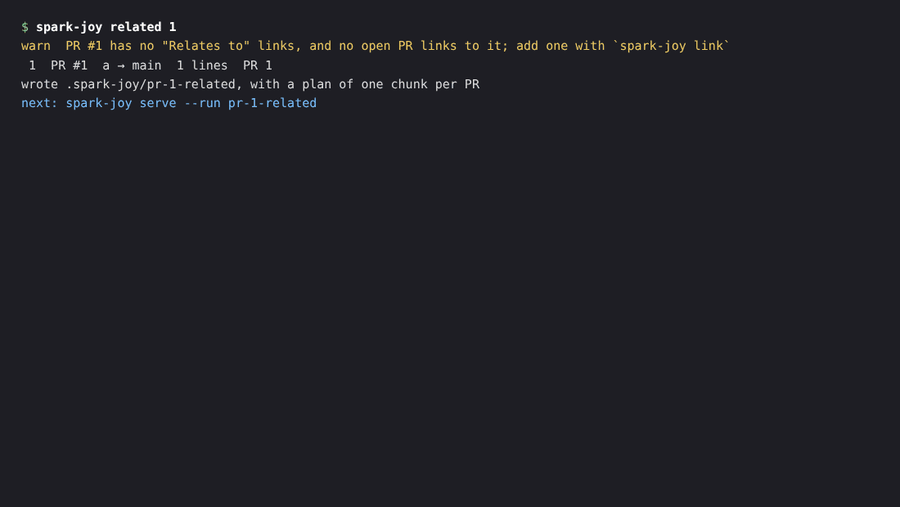
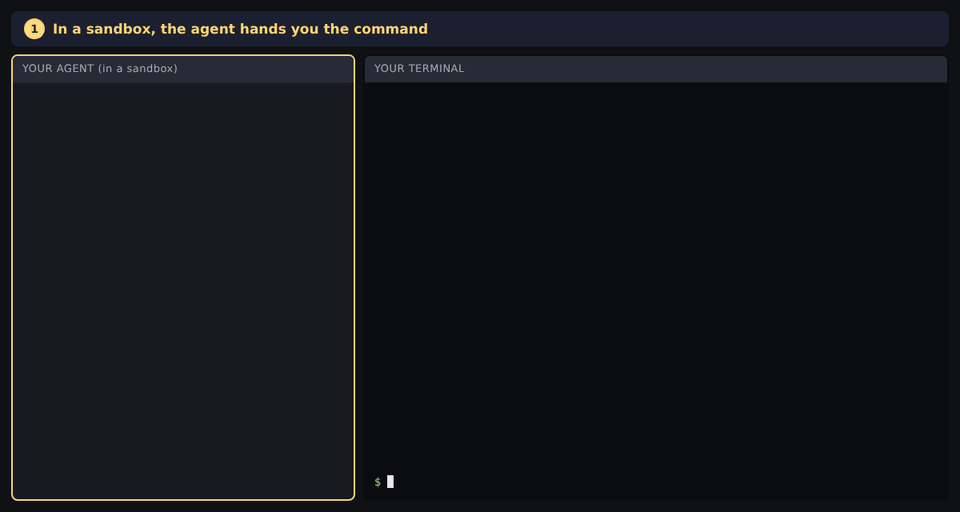

<p align="center">
  
</p>

<h1 align="center">spark-joy</h1>

<p align="center"><em>Make PRs spark joy again.</em></p>

<p align="center">
  <a href="https://www.npmjs.com/package/@dansyuqri/spark-joy"></a>
  
</p>

AI-written PRs are often thousands of lines long: too big to review properly. spark-joy has your coding agent break a big PR into small, ordered pieces, then opens a local app where you review them one at a time.

Works from plain git, so GitHub, GitLab or anything else. Nothing is posted unless you ask.

Inspired by [mr-cast](https://github.com/phanshiyu/mr-cast).

## Key features

### Split a large PR into smaller PRs

Ask your agent to "split my changes into smaller PRs". It turns your staged changes, uncommitted changes or whole branch into a stack of small PRs, each built on the one before. You preview the stack in the app, optionally run your tests on every PR, then get local branches with a title and description for each. Your working tree is never touched and nothing is pushed.

<p align="center"></p>

More in [Split your own changes](#split-your-own-changes).

### Review a large PR by foundations or by feature

Ask your agent to "review this PR in chunks". It groups the diff into chunks of 100–300 lines, in two review orders:

- **Foundations first** goes types → logic → callers → tests.
- **By feature** follows one capability at a time, end to end.

Pick one and switch later without losing progress. Every change lands in exactly one chunk, and spark-joy checks that nothing is missing or reviewed twice. Stacked and related PRs can be broken up the same way.

**Example:** spark-joy's own history, one 7.8k-line diff, became **18 chunks of 141–369 lines**, every hunk placed exactly once. The 2.7k-line lockfile went straight to *skim*.

<p align="center"></p>

More in [Use](#use).

### Review linked PRs together

Some changes span PRs: an API and the client that uses it, or a fix and its follow-up. Add a "Relates to #12" line to a description (or run `spark-joy link`) and `spark-joy related` loads every linked PR into one view, one chunk per PR, each diffed against what it targets. **Across PRs** shows a file in each PR that touches it, and your notes post back to the PR they were left on.

<p align="center"></p>

More in [Review related PRs](#review-related-prs).

## Additional features

- **Stacked PRs.** Load a stack someone already opened on GitHub or GitLab and review it PR by PR. See [Review stacked PRs](#review-stacked-prs).
- **Across chunks / Across PRs.** See one file's diff in every chunk or PR side by side, in order.
- **Map.** Chunks as a graph. Click one to see how its files' diffs link; click a file to review it.
- **Summary.** A *What this PR does* list ties each feature to the chunks that implement it and shows how much of each has been reviewed. Export it all as `review.md`.
- **Post your notes.** Line and chunk notes go to the PR as a pending review (GitHub) or draft notes (GitLab) that only you see until you submit.
- **Mechanical changes are separated.** Lockfiles, generated files, binaries, renames and whitespace-only changes go into a collapsed *skim* section.
- **Risk is agreed, not guessed.** Before labelling anything, the agent proposes what counts as high and medium risk for your repo and waits for you to confirm. The rubric is saved in `.spark-joy.md` at the repo root; commit it to share it with your team.
- **Progress survives new commits.** Review state is stored by hunk content, so after a push you re-extract and only new or changed hunks need another look.
- **Linked code.** Under each file, **Uses** and **Used by** list the other changed files it's linked to; click an underlined name to jump to its definition.
- **Agent or terminal.** Your agent can drive every step, or run any `spark-joy` command yourself. See [Agent or terminal](#agent-or-terminal).
- **Signed commits.** Split branches are signed if your git config has `commit.gpgsign` on.
- **Any agent.** An [Agent Skill](https://agentskills.io) plus a CLI, so it works with Claude Code, Codex, Gemini CLI, Cursor, OpenCode and others.

## How it works

```
spark-joy extract   →  hunks.json    every hunk of the diff gets an id (h001, h012.1, …)
the agent (skill)   →  plan.json     hunks grouped into chunks, in two review orders, plus a feature list
spark-joy validate  →  ok / errors   every non-mechanical hunk is in exactly one chunk, sizes are sane
spark-joy serve     →  review app    choose an order, review chunk by chunk, export review.md
```

- **The agent never copies code into the plan.** It refers to hunks by id, and `validate` checks that no change is missing or reviewed twice.
- **Chunks stay small.** The target is 100–300 changed lines and validation warns above 400. Large hunks are split at function boundaries so they can go into different chunks.

## Install

Requires Node 24 or newer and git. Published on npm as [`@dansyuqri/spark-joy`](https://www.npmjs.com/package/@dansyuqri/spark-joy).

spark-joy is an [Agent Skill](https://agentskills.io) plus a CLI, so it works with Claude Code, Codex, Gemini CLI, Cursor, OpenCode and other agents that read `SKILL.md`.

```sh
npm install -g @dansyuqri/spark-joy
spark-joy install-skill
```

`install-skill` copies the skill to `~/.claude/skills` (Claude Code) and `~/.agents/skills` (Codex, Gemini CLI, Cursor, OpenCode and others).
- `--agent claude` or `--agent agents` installs to one of them only.
- `--project` installs into the repo.
- `--print` prints the skill for agents without skill support: paste it into `AGENTS.md` or the agent's instructions.

In Claude Code you can install it as a plugin instead:

```
/plugin install spark-joy --marketplace Dansyuqri/spark-joy
```

## Use

Inside the repo with the branch checked out, ask your agent to "review this PR in chunks" (in Claude Code, `/spark-joy` also works). The agent extracts the diff, reads it, writes and validates the plan, and starts the app at http://127.0.0.1:4848.

In the app:

- `j` / `k` move between chunks and `x` toggles reviewed.
- Tick **Viewed** on a file's header to mark it reviewed and collapse it. A chunk is done once all its files are viewed. File headers stay pinned while you scroll, so you can tick or collapse without scrolling back up.
- Under each file, **Uses** and **Used by** list the other changed files it's linked to, with the chunk each sits in. Names defined in another file are underlined in the diff; click one to jump to its definition, and use the browser's Back to return.
- **Across chunks** (**Across PRs** for a split) on a file's header shows that file's diff in every chunk side by side, in order, so you can follow how it changes from one to the next. Chunks that leave the file alone show *No changes in this PR*.
- Click a line number to leave a note on that line.
- Use **↑ 20**, **↓ 20** or **Show all** between hunks to see more context, or **View file** to see the whole file.
- **Summary → Export review.md** writes a markdown report with progress, notes (including `file:line`) and the feature list.

On GitHub or GitLab, ask your agent to "post my notes to the PR", or run `spark-joy comments --post` yourself. Your notes go up word for word as a pending review (GitHub) or draft notes (GitLab) that only you can see until you submit them. Line notes land inline on their line; chunk notes go in the review body. It checks the PR is still at the commit you reviewed first, and the agent never adds comments of its own.

### Agent or terminal

Your agent drives every step: ask it and it runs the commands. The only step that needs the agent is planning (reading the diff and grouping it); everything else is a `spark-joy` command.

Every command ends with a `next:` line saying what comes next: a command to run, or what to ask your agent. If your agent runs in a sandbox that can't start a server, write to `.git` or reach GitHub, it gives you that command to run in your terminal instead, and the `next:` line there tells you when to go back to the agent. Lost track? `spark-joy status` says where a run stands.

<p align="center"></p>

### Commands

| Command | What it does |
| --- | --- |
| `spark-joy extract [base] [--working]` | Diff `merge-base(base, HEAD)..HEAD` (or the working tree) into a run in `.spark-joy/<branch>/` |
| `spark-joy extract --staged \| --uncommitted` | Diff `HEAD` against the index or the working tree, for splitting |
| `spark-joy stack <pr> \| --prs a,b,c` | Load existing stacked PRs or MRs into a run, one chunk per PR (the agent can break big ones up) |
| `spark-joy related <pr> \| --prs a,b,c` | Load a PR and every PR it relates to ("Relates to" links, both ways) into one run, each against its own base |
| `spark-joy link <pr> <prs…>` | Add a "Relates to" line naming the other PRs to the first PR's description |
| `spark-joy status` | Where a run stands, and the `next:` step |
| `spark-joy outline` | Compact list of every file and hunk with sizes and flags |
| `spark-joy show <ids…> \| --file <path>` | Print hunks in full; accepts ranges like `h003..h010` |
| `spark-joy links` | Cross-file links: which hunk uses a name another defines |
| `spark-joy rubric` | Print the agreed risk rubric from `.spark-joy.md` |
| `spark-joy validate [--json]` | Check `plan.json` against the hunks |
| `spark-joy serve [--port n]` | Start the review app |
| `spark-joy export [--stdout]` | Write `review.md` |
| `spark-joy comments [--gitlab] [--stdout]` | Write `comments.json`: your notes as a pending GitHub review or GitLab draft notes; one file per PR for a stack |
| `spark-joy comments --post [--pr n]` | Post them through `gh` or `glab`, pending until you submit |
| `spark-joy split [--check cmd] [--apply]` | Turn a split plan into stacked local branches |
| `spark-joy install-skill [--agent a] [--project] [--print]` | Install the agent skill |

`base` defaults to `origin/HEAD`, then `origin/main`, `origin/master` or `main`. Runs are stored in `.spark-joy/`, which ignores itself in git.

The plan format is documented in [SKILL.md](plugin/skills/spark-joy/SKILL.md), and the schema is in [shared/schema.ts](shared/schema.ts).

## Split your own changes

Writing the big PR yourself? Ask your agent to "split my changes into smaller PRs". It turns your staged changes, uncommitted changes or whole branch into small PRs, each built on the one before.

<p align="center"></p>

1. **Extract** what you want to split: `--staged`, `--uncommitted`, or a base branch for the whole branch.
2. **Plan.** The agent groups every change into ordered PRs: each must build on the ones before, and lockfiles go with the change that needs them. Preview the stack in the app; the Map shows how the PRs depend on each other.
3. **Check.** `split` builds the PRs and confirms the last one matches your changes exactly. `--check` runs your tests on each PR in a temporary worktree.
4. **Apply.** `split --apply` creates the local branches and writes each PR's title and description to `prs.md`. Nothing is pushed. The commits are signed if your git config has `commit.gpgsign` on.

```sh
spark-joy extract --uncommitted                 # or --staged, or a base for the whole branch
spark-joy split                                 # dry run
spark-joy split --check "npm ci && npm test"    # optional
spark-joy split --apply                         # creates <branch>-split/1-…, 2-…
```

Your working tree, staged files and current branch are never touched: the PRs are built from a temporary git index. If anything doesn't add up, no branches are created.

## Review stacked PRs

Got a stack of PRs on GitHub, or MRs on GitLab, where each one is based on the branch of the one below? Load them and review them like a split: one chunk per PR, with **Across PRs** showing how a file changes from PR to PR.

```sh
spark-joy stack 12                  # or a PR/MR URL; any PR in the stack works
spark-joy stack --prs 12,13,14      # exactly these, bottom first
spark-joy serve --run pr-12-stack
```

- It finds the rest of the stack by following base branches down and open PRs based on each head up. If two PRs build on the same one, it follows the lower number and says so; use `--prs` to pick.
- Each PR is fetched (`refs/pull/N/head` or `refs/merge-requests/N/head`, kept under `refs/spark-joy/`) and diffed against the PR below it, so you see only what that PR changes, even where it rewrites lines from an earlier PR.
- The plan is written for you from each PR's title and description, with a link to the PR. Your agent can add risk and review focus; they're kept when you import the stack again after new pushes.
- Big PRs can be broken up too: the agent adds *Foundations first* and *By feature* orders that split each PR into chunks, PR by PR, listed under the PR they come from. Pick one on the Plan page or stay with *Whole PRs*; progress carries over between them. **Across PRs** still shows one panel per PR in every order.
- It talks to the forge through `gh` or `glab`, so it uses their login and stores no tokens. The forge comes from the remote's host; pass `--forge github|gitlab` for a self-hosted one whose name doesn't say, and `--remote` if the PRs aren't on `origin`.
- `comments --post` (or asking your agent to post your notes) sends each one to the PR it was left on, as a pending review (or draft notes) on that PR's head, with line notes on that PR's own diff lines. It posts nothing if any PR has moved on since you loaded it. A chunk note goes to its PR; a chunk that spans PRs goes to the highest one and names the others. If a PR doesn't target the one below it (`--prs` warned), its line notes go in its review body instead of inline.

## Review related PRs

Some changes span PRs that aren't a stack: an API and the client that uses it, each on `main`, or a fix and its follow-up. Link them in a description and review them in one place, one chunk per PR, with **Across PRs** showing a file in each PR that touches it.

```sh
spark-joy related 12                # or a PR/MR URL
spark-joy related --prs 12,15,20    # exactly these, no links needed
spark-joy link 12 15 20             # adds "Relates to #15, #20" to #12's description
spark-joy serve --run pr-12-related
```

- It follows `Relates to #15` lines (also `Related:`, `Related PRs:`, PR URLs, and `!15` on GitLab) from PR to PR, and finds open PRs that link back. One link anywhere connects two PRs. Links to other repos are listed but not loaded.
- Each PR is diffed against what it targets: its base branch, or, when it's based on another PR in the run, that PR. The review page says which ("targets main", "builds on #12").
- Everything else works as for a stack: the agent can break big PRs up, and `comments --post` sends each note to the PR it was left on, inline on that PR's own lines.

## Develop

```sh
npm install
npm run build        # CLI (tsup) and app (Vite)
npm test             # unit and integration tests
npm run test:e2e     # browser walkthrough of the app (Playwright + Chromium)
npm run typecheck
npm run dev:app      # Vite dev server; proxies /api to a running `spark-joy serve`
```

Layout:

- `cli/`: commands, diff parsing, splitting, classification, server, stacked-branch builder.
- `shared/`: schemas, validation and derived state, used by both the CLI and the app.
- `src/`: the React review app.
- `plugin/`: the skill, packaged as a Claude Code plugin.
- `test/`: Vitest, with a fixture git repo.
